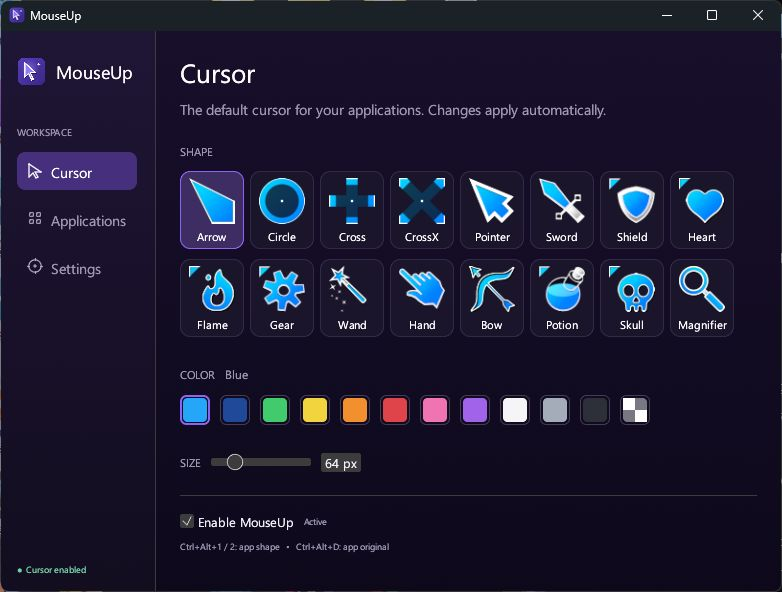
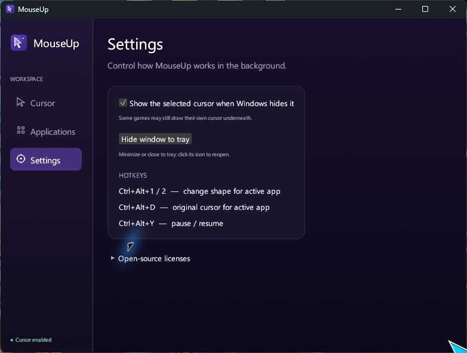

# MouseUp

A free, open-source YoloMouse alternative for Windows, written in Rust. Choose a cursor shape, color and size for all apps or save a different cursor for each game or application.

 

- 16 cursor shapes, 12 colors and adjustable size.
- Per-app choices, global cursor, and an option to restore the original.
- Runs in the notification area; right-click its icon and select **Exit MouseUp** to quit.
- **Hotkeys:** `Ctrl+Alt+1/2` change shape, `Ctrl+Alt+D` restore the active app's cursor, `Ctrl+Alt+Y` pause or resume.

[Build instructions](docs/build.md) · [Compatibility and investigation](docs/investigation.md) · [MIT license](LICENSE)

**Cursor artwork:** the original YoloMouse cursor files are not included in this repository or covered by the MIT license. Building the standalone EXE requires a compatible YoloMouse MSI; redistribution rights for the artwork have not been established. MouseUp is independent and not affiliated with YoloMouse.
